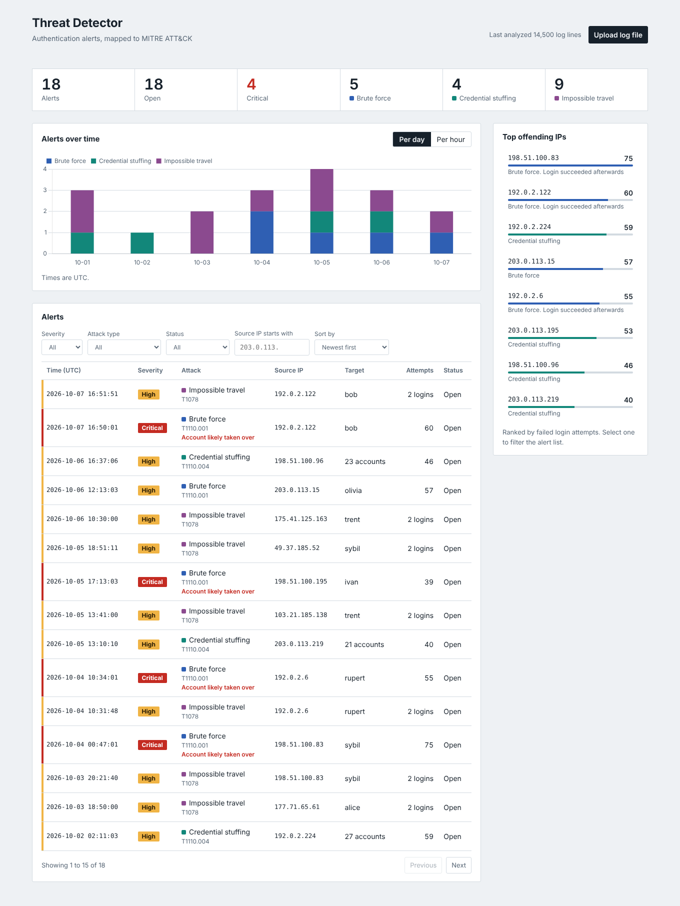
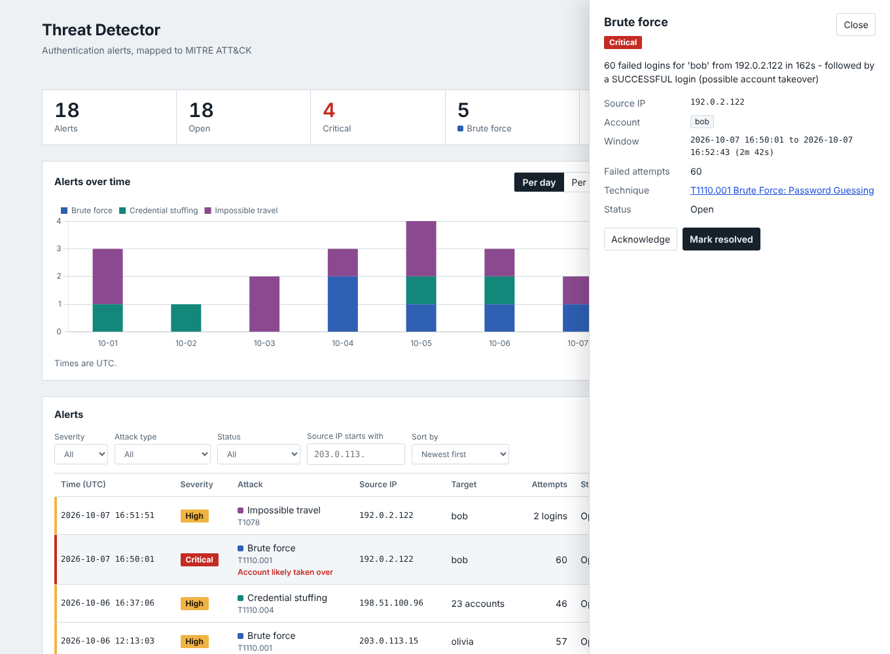

# Threat Detector

A log-based threat detection system. It ingests authentication logs, detects
suspicious activity (brute force, credential stuffing, impossible travel, plus an
Isolation Forest layer for low-and-slow attacks the rules cannot see), stores
alerts in SQLite, and shows them on a live dashboard backed by a FastAPI service.



> Status: all 5 steps complete (generator, parser, rules, ML layer, scorer, API, dashboard, Docker)
> Tested on Ubuntu 22.04 (Python 3.10).

## What it detects

| Detector | Signal | MITRE ATT&CK |
|---|---|---|
| Brute force | many failed logins for the same account from one IP in a short window | T1110.001 Password Guessing |
| Credential stuffing | one IP failing against many different usernames | T1110.004 Credential Stuffing |
| Impossible travel | same account logs in from two places too far apart for the elapsed time | T1078 Valid Accounts |
| ML anomaly | an IP-hour whose behaviour is far outside a clean baseline (Isolation Forest), with a plain-language reason | T1110 Brute Force |

Brute-force and stuffing alerts are escalated to **critical** when a successful
login from the same IP follows the attack (possible account takeover).
All thresholds live in `DetectorConfig` (`src/detectors/base.py`).

## Quick start (Ubuntu 22.04)

```bash
bash setup.sh                         # installs deps, generates logs, runs everything
source venv/bin/activate
uvicorn src.api:app --reload          # then open http://127.0.0.1:8000
```

Manual path (same thing, step by step):

```bash
sudo apt update
sudo apt install -y python3 python3-venv python3-pip git

python3 -m venv venv            # on Ubuntu the command is python3, not python
source venv/bin/activate        # after this, `python` works inside the venv
pip install -r requirements.txt

python src/generator.py              # writes data/auth.log + data/ground_truth.json
python -m src.main                   # run detectors and score them against the answer key
python -m src.ingest data/auth.log   # load alerts into data/threat.db
uvicorn src.api:app --reload         # dashboard at http://127.0.0.1:8000
python -m pytest                     # run tests
```

Run commands from the project root (the folder containing `src/`).
Every new terminal: `cd threat-detector && source venv/bin/activate`.

You can also analyze any log of the same format from the dashboard with **Upload log file**.

## Run with Docker

```bash
docker compose up --build        # http://localhost:8000
```

First start trains the model and loads a simulated hard log. Set `THREAT_READONLY=1` for a
public demo (uploads and triage return 403). Environment: `THREAT_DB`, `THREAT_MODEL`,
`THREAT_TRUSTED_NETWORKS`, `THREAT_READONLY`, `THREAT_MAX_UPLOAD`. See `docs/DEPLOY.md`.

## Dashboard

* Summary figures, alerts over time (per day or per hour, split by attack type)
* Top offending IPs ranked by failed attempts; select one to filter the list
* Filter by severity, attack type, status and IP prefix; sort; paginate
* Click an alert for its window, targeted accounts and MITRE technique, then
  acknowledge or resolve it
* Follows your system light/dark setting; works on a phone-width screen



## API

Interactive docs are generated automatically at `/docs`.

| Method | Path | Purpose |
|---|---|---|
| GET | `/api/health` | liveness and alert count |
| POST | `/api/ingest` | body is raw log text; runs detectors and stores alerts (`?replace=false` to append) |
| GET | `/api/alerts` | filters: `severity`, `type`, `status`, `ip` (prefix), `since`, `until`; `sort`, `order`, `limit`, `offset` |
| GET | `/api/alerts/{id}` | one alert |
| PATCH | `/api/alerts/{id}` | set `status` to `open`, `acknowledged` or `resolved` |
| GET | `/api/stats` | totals, breakdowns, top offending IPs, last ingest |
| GET | `/api/timeline` | alert counts per `day` or `hour` and attack type |

Example:

```bash
curl -X POST localhost:8000/api/ingest --data-binary @data/auth.log
curl "localhost:8000/api/alerts?severity=critical&sort=count"
```

## Security notes

* **SQL injection:** every query is parameterised; sort columns come from a fixed allowlist.
* **Log injection:** a username containing `result=SUCCESS` could forge fields, so the parser
  rejects any line with a repeated key.
* **XSS:** usernames come from the log and are attacker-controlled. The dashboard builds its
  page with `textContent`, never `innerHTML`, and a test checks that HTML in a username is shown as text.
* **Uploads:** capped at 50 MB (`THREAT_MAX_UPLOAD` to change); the client never supplies a file path.
* Set `THREAT_DB` to move the database file.

## Project structure

```
threat-detector/
├── data/                       # generated logs, alerts and database (git-ignored)
├── docs/                       # screenshots
├── src/
│   ├── generator.py            # simulates normal traffic + attacks, writes answer key
│   ├── parser.py               # log parser (dataclass + DataFrame)
│   ├── detectors/              # brute_force, credential_stuffing, impossible_travel
│   ├── ml/                     # features, Isolation Forest model, training CLI
│   ├── pipeline.py             # hybrid: rules first, ML only for what rules missed
│   ├── benchmark.py            # rules vs ML vs hybrid on held-out seeds
│   ├── evaluate.py             # scores alerts against ground_truth.json
│   ├── main.py                 # CLI pipeline: parse -> detect -> report -> score
│   ├── db.py                   # SQLite storage and queries
│   ├── ingest.py               # log text -> alerts -> database (library + CLI)
│   ├── api.py                  # FastAPI app, serves the dashboard
│   └── static/                 # dashboard (index.html) and vendored Chart.js
├── tests/
├── Dockerfile, docker-compose.yml, docker-entrypoint.sh
├── setup.sh                    # one-shot Ubuntu setup
├── requirements.txt
└── README.md
```

## Results

All numbers are from **synthetic** logs with injected attacks, on seeds 1-5 that were never
used for tuning (tuning used seeds 101-103). The model is trained once on a clean simulated
month. Regenerate with `python -m src.benchmark` (writes `docs/benchmark.md` and `.json`).


### Easy data  (72,487 events)

| detector | attacks caught | recall | loud recall | low-and-slow recall | alerts | false alarms | precision | F1 |
|---|---|---|---|---|---|---|---|---|
| rules | 75/75 | 100% | 75/75 (100%) | n/a | 81 | 0 | 100% | 1.00 |
| ml | 45/75 | 60% | 45/75 (60%) | n/a | 45 | 0 | 100% | 0.75 |
| hybrid | 75/75 | 100% | 75/75 (100%) | n/a | 81 | 0 | 100% | 1.00 |
| hybrid + allowlist | 75/75 | 100% | 75/75 (100%) | n/a | 81 | 0 | 100% | 1.00 |

### Hard data  (74,366 events)

| detector | attacks caught | recall | loud recall | low-and-slow recall | alerts | false alarms | precision | F1 |
|---|---|---|---|---|---|---|---|---|
| rules | 75/110 | 68% | 75/75 (100%) | 0/35 (0%) | 133 | 46 | 65% | 0.67 |
| ml | 80/110 | 73% | 45/75 (60%) | 35/35 (100%) | 80 | 0 | 100% | 0.84 |
| hybrid | 110/110 | 100% | 75/75 (100%) | 35/35 (100%) | 168 | 46 | 73% | 0.84 |
| hybrid + allowlist | 110/110 | 100% | 75/75 (100%) | 35/35 (100%) | 153 | 31 | 80% | 0.89 |

What the table says, honestly:

* On loud attacks the rules are perfect and the ML layer adds nothing (it also does not
  detect impossible travel, which is why ML alone scores 60% on easy data).
* On the hard data the rules miss **all 35 low-and-slow attacks** (they stay under any
  "N failures in 5 minutes" threshold). The Isolation Forest catches all 35 with zero
  false alarms, because it looks at a whole hour of behaviour.
* The hybrid keeps the rules' precision on loud attacks and fills the ML's blind spot.
* The remaining false alarms are VPN users flagged by impossible travel. Shared-office
  login storms are removed by an allowlist (`THREAT_TRUSTED_NETWORKS`), which is context
  the organisation supplies, not something the model learns.

Caveats: the data is simulated, the training baseline is assumed to be clean, and slow
attacks here come from a generator I wrote, so real traffic will be messier.

## Limitations (known, deliberate)

* Impossible-travel baseline ("usual city") is computed over the whole batch; a
  streaming version would keep a rolling per-user baseline.
* VPN users still trigger impossible-travel false alarms; fixing that needs per-user VPN knowledge.
* The model needs a clean baseline to train on; poisoned history would raise its threshold.
* Rule thresholds are fixed; only the ML layer learns from data.
* Ingest replaces the stored alerts by default (one upload = one snapshot); there is no login or multi-user access control.

## Troubleshooting

| Problem | Fix |
|---|---|
| `python: command not found` | Use `python3` outside the venv, or activate the venv first |
| `ensurepip is not available` / venv creation fails | `sudo apt install python3-venv` |
| `ModuleNotFoundError: No module named 'src'` | Run commands from the project root |
| `No module named pytest` / `uvicorn: command not found` | The venv isn't active: `source venv/bin/activate` |
| `Address already in use` | Another server is on port 8000: `uvicorn src.api:app --port 8001` |
| Dashboard says "No alerts yet" | Run `python -m src.ingest data/auth.log`, or use **Upload log file** |

## Roadmap

1. Project setup and log generator
2. Log parser
3. Rule-based detectors, tests and scorer
4. FastAPI backend and dashboard
5. ML anomaly detection, harder attack scenarios, Docker, deploy (done; see docs/DEPLOY.md)
